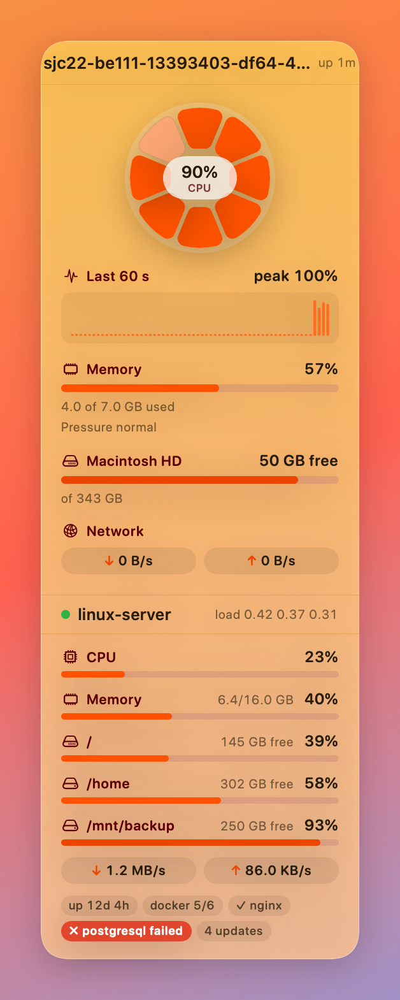
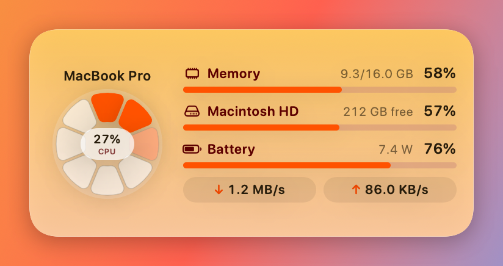
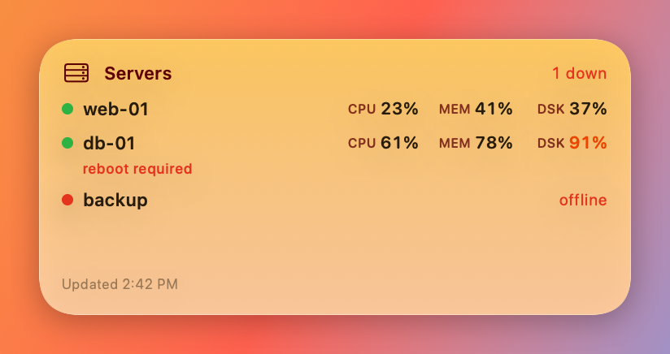

# MacMonitor

A light menu bar app, desktop panel and **desktop widgets** that show your Mac's resources —
and your **Linux and Mac servers over plain SSH**, with nothing to install on them.



| This Mac widget | Servers widget |
| --- | --- |
|  |  |

## Features

**This Mac**
- Menu bar: choose any of CPU, memory, GPU, network, battery, CPU temperature — as text or with a
  small CPU graph.
- Desktop panel that sits behind your windows on every Space: CPU ring + history, memory (with
  pressure and swap), GPU, battery (charge, power draw, time left), temperatures and fans,
  every local disk, network, and the top 3 processes. Warm, dark or system theme; three sizes;
  pin it to a screen corner or drag it anywhere.
- Widgets (Notification Center, and the desktop on macOS 14+): *This Mac* in small, medium and
  large; the large one also lists your servers.

**Servers**
- One long-lived SSH session per server runs a tiny POSIX `sh` loop. No agent, no daemon.
- Log in with the system `ssh` (your keys, ssh-agent, `~/.ssh/config`; direct edition) or the
  built-in SSH client with a private key file or a password kept in the Keychain (both editions).
- Linux: CPU, memory, every real filesystem, network, load, uptime, Docker containers, chosen
  systemd services, `reboot-required`, pending apt/dnf updates.
- macOS servers: CPU, memory, disks, network, load, uptime.
- *Servers* widget, per-server compact mode, hide filesystems, reorder, edit.
- Import hosts from `~/.ssh/config`; "Open SSH in Terminal"; "Copy SSH Command".

**Alerts** (macOS notifications, off by default)
- Sustained high CPU, critical memory pressure, disk almost full, low battery.
- Server unreachable / back online, server CPU or disk (optional per-server thresholds), a watched
  service stops, a Docker container stops, a TLS certificate is close to expiry, reboot required.
- The same alerts can also go to Telegram, Slack (incoming webhook) or any HTTPS webhook.
  Bot tokens and webhook URLs are stored in the login Keychain.

## Install

**Download** the DMG from [Releases](https://github.com/expertosa/MacMonitor/releases), open it and
drag MacMonitor to Applications. Or with Homebrew (once the tap is published, see `Casks/`):
```bash
brew install --cask expertosa/tap/macmonitor
```
If the release is ad-hoc signed (see its notes), clear the quarantine flag once:
```bash
xattr -dr com.apple.quarantine /Applications/MacMonitor.app
```

To add a widget: right-click the desktop → **Edit Widgets…** (macOS 14+) or open Notification
Center → **Edit Widgets**, then search for *MacMonitor*.

## Editions

| | Direct (DMG / Homebrew) | Mac App Store |
| --- | --- | --- |
| Menu bar, panel, widgets, alerts | ✓ | ✓ |
| SSH servers + Servers widget | ✓ | ✓ (built-in SSH client) |
| Login via system `ssh` (agent, `~/.ssh/config`, ProxyJump) + config import | ✓ | – (sandbox) |
| Login with key file / password (built-in client) | ✓ | ✓ |
| Temperatures, fans, top processes | ✓ | – (blocked by the sandbox) |
| Update check | GitHub Releases | App Store |

## Build from source

Requirements: macOS 13+, Xcode 15+ (or only the Command Line Tools for the quick build).

**Full app with widgets** (needs Xcode and [XcodeGen](https://github.com/yonaskolb/XcodeGen)):
```bash
brew install xcodegen
cd Xcode && xcodegen generate
open MacMonitor.xcodeproj          # schemes: MacMonitorDirect, MacMonitorAppStore
```
Signed, notarized DMG for distribution:
```bash
NOTARY_PROFILE=my-profile Xcode/release_direct.sh
```
App Store archive + upload:
```bash
Xcode/archive_upload.sh
```

**Quick build without widgets** (Command Line Tools only):
```bash
./build_app.sh && open MacMonitor.app
```

**Tests** (the core library also builds and tests on Linux):
```bash
swift test
```

### Project layout
```
Sources/MacMonitorCore   parsing, local samplers, alerts, ssh_config import, widget data (Foundation only)
Sources/MacMonitorUI     SwiftUI theme + meters + widget views shared by the panel and the widget
Sources/MacMonitor       the app: menu bar, desktop panel, settings, SSH sessions, SMC, notifications
Widget/                  WidgetKit extension
Xcode/                   XcodeGen spec, entitlements, signing / release scripts
Tests/                   unit tests for MacMonitorCore
```

## Monitoring servers over SSH

**1. Choose how MacMonitor logs in** (the *Login* field in the server editor):

- **System ssh** (direct edition, recommended): runs `/usr/bin/ssh` with your keys, ssh-agent and
  `~/.ssh/config`. It uses `BatchMode=yes`, so key login must work without a prompt (see below).
- **Private key file**: the built-in client (SwiftNIO SSH via [Citadel](https://github.com/orlandos-nl/Citadel)).
  Pick an OpenSSH-format ed25519 or RSA key (`~/.ssh/id_ed25519`); passphrase-protected keys work.
  The key and passphrase are copied into your login Keychain. PEM keys (`BEGIN RSA PRIVATE KEY`)
  can be converted in place with `ssh-keygen -p -f <key>`. ECDSA keys aren't supported yet.
- **Password**: the built-in client with a password stored in the Keychain.

The built-in client trusts a server's host key on first connect and refuses a different key later
(**Servers → <name> → Trust New Host Key** after a reinstall). It has no ProxyJump / agent support.

For system ssh, set up key-based login first:
```bash
ssh-keygen -t ed25519            # only if you don't have a key yet
ssh-copy-id user@host
ssh user@host true               # must succeed without a password prompt
```
A key with a passphrase works if it's in the agent / keychain (`ssh-add --apple-use-keychain ~/.ssh/id_ed25519`).
New host keys are accepted on first connect (`StrictHostKeyChecking=accept-new`); a *changed* host key is refused.

**2. Add servers:** menu bar → **Add Server…**, or **Import from ~/.ssh/config…**. Imported entries
connect through their alias, so `ProxyJump`, `IdentityFile` and other options keep working.
Optionally list systemd **services** to watch (e.g. `nginx postgresql`).

**3. Manage:** menu bar → **Servers → <name>** (Open SSH in Terminal, Copy SSH Command, Edit,
Compact, Reconnect, Remove) or **Settings → Servers** (reorder, compact, hide disks).

How it works:
- The remote loop prints `/proc/stat`, `/proc/meminfo`, `df`, `/proc/net/dev` and `/proc/loadavg`
  every 2 s (on macOS: `sysctl`, `vm_stat`, `df`, `netstat`, `top`). Slower checks (services,
  Docker, reboot flag) run every minute and the update count every 30 minutes.
- Failed connections show ssh's error and retry after 5 s, 10 s, 30 s, then every 60 s.
  Dead links are detected within ~30 s (`ServerAliveInterval=15`, `ServerAliveCountMax=2`).
- Network totals skip `lo` and container links (`veth*`, `docker*`, `br-*`, …) so traffic isn't
  counted twice. Disks skip tmpfs/overlay/squashfs, `/boot*`, `/snap*`, `/run*`.
- The server list is JSON in the user defaults: `defaults delete com.tweetso.macmonitor remoteServers` resets it.

## Snapshots (screenshots without a screen)
```bash
swift build -c release
MM_SNAPSHOT=/tmp/panel.png .build/release/MacMonitor                       # panel, warm theme
MM_SNAPSHOT=/tmp/dark.png MM_SNAPSHOT_THEME=dark .build/release/MacMonitor # panel, dark theme
MM_WIDGET_SNAPSHOT=/tmp/widgets .build/release/MacMonitor                  # every widget size
```
Snapshot mode makes no SSH connections; it shows a demo `linux-server`. CI renders these on every push.

## Notes
- The app is an accessory app (`LSUIElement`): no Dock icon. Quit it from the menu bar.
- Launch at Login uses `SMAppService` and works from the `.app` bundle (best from `/Applications`).
- Reset the saved panel position: `defaults delete com.tweetso.macmonitor panelOrigin`.
- Widgets refresh on WidgetKit's schedule (every few minutes). The app asks for an immediate
  refresh when a server changes state.
- Temperatures and fans are read from the SMC; sensor keys differ between Mac models, so some
  models show nothing.

## License
[MIT](LICENSE)
